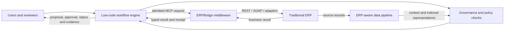
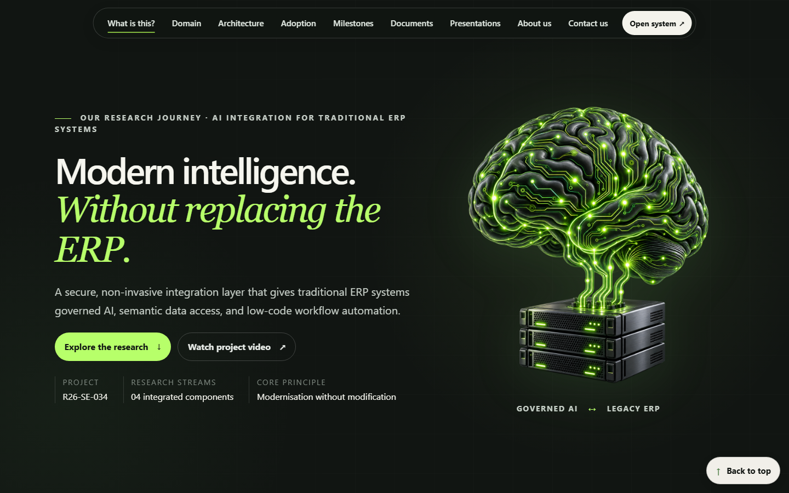

# R26-SE-034 — AI Integration for Traditional ERP Systems

> Modern intelligence without replacing the ERP.

This research project investigates how an existing ERP can gain governed AI,
semantic data access, standardised tool interoperability, and editable low-code
workflow automation without invasive changes to the ERP core.

<p align="center">
  <a href="https://lksnjw.github.io/r26-se-034-research-website/dist/index.html">
    
  </a>
</p>

<p align="center">
  <a href="https://lksnjw.github.io/r26-se-034-research-website/dist/index.html"><strong>Live research website</strong></a>
  ·
  <a href="https://drive.google.com/file/d/1UXPm-Pk0mHj0LeoM3TYtZu3Zz_PE9G3X/view?usp=sharing"><strong>Project video</strong></a>
  ·
  <a href="https://toolplane.nimendra.online/"><strong>ERPBridge portal</strong></a>
  ·
  <a href="https://drive.google.com/drive/folders/1TfkGkhFG9F6Ok6oGZvRYKEkn0S80dmH7?usp=sharing"><strong>Research documents</strong></a>
</p>

## Contents

- [Project overview](#project-overview)
- [Research question and objectives](#research-question-and-objectives)
- [Integrated architecture](#integrated-architecture)
- [Repository structure](#repository-structure)
- [Research components](#research-components)
- [Technology and tools](#technology-and-tools)
- [Run the components locally](#run-the-components-locally)
- [Source code and documentation index](#source-code-and-documentation-index)
- [Evaluation evidence and claim boundaries](#evaluation-evidence-and-claim-boundaries)
- [Video, diagrams, charts, and website assets](#video-diagrams-charts-and-website-assets)
- [Research documents and presentations](#research-documents-and-presentations)
- [Team](#team)
- [Branches and related repositories](#branches-and-related-repositories)

## Project overview

Traditional ERP platforms remain dependable systems of record, but rigid
workflows, vendor-specific extensions, fragmented interfaces, and expensive
customisation make AI adoption difficult. A language model alone is not an
execution authority: it can propose a convincing operation without possessing
the required role, approval, current business state, or exact tool parameters.

R26-SE-034 places a controlled integration layer around the ERP:

1. **Describe** — a user states a business objective or selects a workflow area.
2. **Propose** — the AI layer creates an editable workflow proposal from reviewed context and capabilities.
3. **Validate** — deterministic server checks evaluate schemas, roles, policy, approval requirements, segregation of duties, and workflow invariants.
4. **Approve** — sensitive operations pause for an independent human decision where that lifecycle is supported.
5. **Execute and record** — ERPBridge invokes an admitted legacy capability, while the workflow engine records state, receipts, outcomes, and recovery evidence.

The intended operating principles are:

- **Non-invasive:** the legacy ERP remains the system of record.
- **Human-governed:** generation, publication, approval, and execution are separate actions.
- **Protocol-based:** MCP and reviewed tool contracts provide a common integration boundary.
- **Evidence-aware:** a connector accepting a request is not treated as proof that the business operation completed.
- **Incremental:** organisations can begin with reviewed read-only tools and expand only after qualification.

## Research question and objectives

### Central research question

> How can legacy ERP systems gain agentic AI and adaptable automation without
> invasive source-code changes?

### Research objectives

| Area | Objective |
|---|---|
| AI governance | Constrain model-assisted decisions using ERP context, user roles, policy rules, retrieval, and verifiable checks. |
| Middleware | Expose approved legacy REST/SOAP functions through secure, reusable MCP tool contracts. |
| Low-code workflows | Convert business intent into editable workflow definitions that are validated before consequential execution. |
| Semantic data | Prepare heterogeneous ERP information for contextual retrieval while preserving the structured source of truth. |
| Evaluation | Measure component behaviour with controlled cases, explicit baselines, recorded results, and clearly stated limitations. |

## Integrated architecture

[](https://lksnjw.github.io/r26-se-034-research-website/dist/assets/system-architecture.svg)

The full-resolution architecture diagram is also available from the
[research-website source repository](https://github.com/lksnjw/r26-se-034-research-website/blob/main/dist/assets/system-architecture.svg).



### Responsibility boundaries

| Component | Owns | Does not automatically prove |
|---|---|---|
| Low-code workflow engine | Workflow authoring, validation, capability admission, governed orchestration, persistence, recovery, and user-facing evidence | That every external ERPBridge/provider/cloud environment is production-qualified |
| Governance model and policy gate | ERP-domain reasoning support, policy retrieval, deterministic checks, conditions, and citations | Permission to execute an ERP action by itself |
| ERPBridge | MCP transport, tool discovery, authentication/authorisation, adapter invocation, resilience, caching, and operational tooling | That a downstream business transaction completed unless the returned evidence establishes it |
| ERP-aware data pipeline | Ingestion, transformation, embedding/index preparation, and retrieval context | Authority to modify the ERP source of truth |
| Legacy ERP | Authoritative enterprise records and business operations | Governance of an AI-generated plan outside its own controls |

No unrestricted model response should directly become an ERP write. Reviewed
capability contracts, current identity/role checks, deterministic validation,
and any required independent approval remain separate control points.

## Repository structure

The integrated research architecture contains **four research streams**, while
this repository currently stores **three top-level code folders**. The data
pipeline is represented by its research documents, website section, integration
configuration, and ERPBridge tool manifests; a fourth top-level pipeline source
folder is not present in this repository.

```text
R26-SE-034/
├── ERPBridge/            # Standardised MCP middleware and mock ERP
├── FineTuneModel/        # Fine-tuning experiments and finance policy/RAG gate
├── low_code_platform/    # Workflow UI, orchestration backends, tests, and evidence
└── README.md             # Integrated project hub
```

| Main-branch folder | Component branch | Primary contribution |
|---|---|---|
| [`ERPBridge/`](./ERPBridge) | [`ERPBridge`](https://github.com/lksnjw/R26-SE-034/tree/ERPBridge/ERPBridge) | Standardised middleware and secure MCP boundary |
| [`FineTuneModel/`](./FineTuneModel) | [`FineTuneModel`](https://github.com/lksnjw/R26-SE-034/tree/FineTuneModel/FineTuneModel) | ERP-domain model experiments and policy governance |
| [`low_code_platform/`](./low_code_platform) | [`low_code_platform`](https://github.com/lksnjw/R26-SE-034/tree/low_code_platform/low_code_platform) | Agentic low-code workflow automation engine |

The branch histories are joined on `main` through merge commits. Existing
component commits remain in the ancestry instead of being flattened into one
artificial import commit.

## Research components

### 1. Fine-Tuned Machine Learning Governance Model

**Owner:** Hansaja A. M. G. — IT22171856

This stream explores ERP-domain model adaptation and policy-aware decision
support. The repository includes LoRA-oriented model experiments, JSONL ERP
datasets, an Ollama evaluation script, and a finance policy gate that combines
deterministic rules with role-aware retrieval and a citation-constrained judge.

Key areas:

- [`FineTuneModel/evaluate_model.py`](./FineTuneModel/evaluate_model.py) — format and ROUGE-L evaluation through an Ollama-served model.
- [`FineTuneModel/ft_data/`](./FineTuneModel/ft_data) — training and evaluation datasets.
- [`FineTuneModel/llna 3.1 with drive.ipynb`](./FineTuneModel/llna%203.1%20with%20drive.ipynb) — Llama 3.1 notebook workflow.
- [`FineTuneModel/new1_with_113_colab_balanced_finetune_3.ipynb`](./FineTuneModel/new1_with_113_colab_balanced_finetune_3.ipynb) — balanced fine-tuning notebook.
- [`FineTuneModel/Rag/rag-system/`](./FineTuneModel/Rag/rag-system) — FastAPI policy-gate and governed read-assist service.
- [`POLICY_PAYLOAD_CONTRACT.md`](./FineTuneModel/Rag/rag-system/docs/POLICY_PAYLOAD_CONTRACT.md) — expected policy payload contract.
- [`ASSIST_CONTRACT.md`](./FineTuneModel/Rag/rag-system/docs/ASSIST_CONTRACT.md) — read-assistance contract.
- [`INTEGRATION_GUIDE.md`](./FineTuneModel/Rag/rag-system/docs/INTEGRATION_GUIDE.md) — caller integration guide.
- [`src/static/demo.html`](./FineTuneModel/Rag/rag-system/src/static/demo.html) — local policy-gate demonstration UI.

### 2. Standardised Middleware Layer — ERPBridge

**Owner:** Dharmasiri I. D. N. D. — IT22254320

ERPBridge is a Go middleware that exposes selected legacy ERP functions as
discoverable, typed MCP tools. It includes Streamable HTTP and stdio transports,
token authentication, role-based authorisation, a declarative SQLite tool
registry, bounded caching, retry/circuit-breaker behaviour, redacted logging,
Prometheus metrics, a management CLI, and a Python mock ERP.

Key areas:

- [`services/erpbridge-server/`](./ERPBridge/services/erpbridge-server) — server entry point.
- [`tools/bridgectl/`](./ERPBridge/tools/bridgectl) — management CLI.
- [`internal/mcp/`](./ERPBridge/internal/mcp) — MCP server, registry, auth, tool, resource, prompt, and token logic.
- [`mock-erp/`](./ERPBridge/mock-erp) — FastAPI finance, HR, and inventory simulator.
- [`docs/README.md`](./ERPBridge/docs/README.md) — documentation hub.
- [`docs/connectivity.md`](./ERPBridge/docs/connectivity.md) — MCP connectivity and transport guide.
- [`docs/onboarding.md`](./ERPBridge/docs/onboarding.md) — end-to-end onboarding.
- [`erpbridge_postman_collection.json`](./ERPBridge/erpbridge_postman_collection.json) — API/MCP request collection.
- [Live ERPBridge documentation and portal](https://toolplane.nimendra.online/).

### 3. Agentic Low-Code Workflow Automation Engine

**Owner:** Sanjeewa P. D. L. B. — IT22629708

This component turns business intent into an inspectable workflow, separates
model proposals from server authority, validates exact tool and policy contracts,
supports human review paths, and records execution/recovery evidence. The folder
contains the current TypeScript/Fastify backend, a React/Vite frontend, the
earlier Go/Fiber research backend, datasets, qualification scripts, and detailed
checkpoint documentation.

Key areas:

- [`frontend/`](./low_code_platform/frontend) — React workflow workspace, chat, canvas, approvals, execution views, registry, and analytics.
- [`backend-ts/`](./low_code_platform/backend-ts) — current TypeScript/Fastify orchestration runtime.
- [`backend/`](./low_code_platform/backend) — earlier Go/Fiber research implementation and frozen gate experiment.
- [`datasets/`](./low_code_platform/datasets) — workflow and semantic-validation datasets.
- [`docs/`](./low_code_platform/docs) — architecture, verification, integration, and milestone records.
- [`ops/erpbridge/`](./low_code_platform/ops/erpbridge) — local ERPBridge composition and reviewed tool manifests.
- [`scripts/`](./low_code_platform/scripts) — qualification and local demonstration helpers.
- [`frontend/graphify-out/GRAPH_REPORT.md`](./low_code_platform/frontend/graphify-out/GRAPH_REPORT.md) — generated frontend dependency-graph report.

### 4. ERP-Aware Data Transformation Pipeline

**Owner:** Aluthwaththa A. W. D. S. M. — IT22267290

This research stream studies how structured and unstructured ERP data can be
cleaned, transformed, embedded, synchronised, and retrieved without replacing
the original database. Its role in the integrated design is to provide governed
business context to the policy and workflow layers.

Resources available here:

- [Data-pipeline contribution on the research website](https://lksnjw.github.io/r26-se-034-research-website/dist/index.html#data-contribution).
- [Individual proposal](https://drive.google.com/file/d/1XO6spCzW8c2Prn1gd_OuDCihMID6i0xr/view?usp=sharing).
- [Researcher GitHub profile](https://github.com/DishaniS).
- [`data-transformation` ERPBridge manifests](./low_code_platform/ops/erpbridge/manifests/data-transformation) for discovery, canonical-record, indexed-representation, retrieval, and search operations.
- [`backend-ts` pipeline configuration](./low_code_platform/backend-ts/src/config/config.ts) and [`pipeline` route policy](./low_code_platform/backend-ts/src/http/route-policy.ts).

## Technology and tools

| Layer | Technologies and tools | Repository evidence |
|---|---|---|
| Research website | HTML5, CSS3, GitHub Pages, responsive layouts, SVG/PNG assets | [Website source](https://github.com/lksnjw/r26-se-034-research-website) |
| Workflow frontend | React, Vite, React Router, React Query, React Hook Form, XYFlow/React Flow, Zustand, Recharts, Tailwind/PostCSS, Jest | [`frontend/package.json`](./low_code_platform/frontend/package.json) |
| Current workflow backend | Node.js 22+, TypeScript, Fastify, Zod, YAML, Vitest, MCP client, Firebase Admin/Functions, Cloud Firestore, PostgreSQL adapter | [`backend-ts/package.json`](./low_code_platform/backend-ts/package.json) |
| Earlier workflow backend | Go 1.22, Fiber, JWT, Zap, PostgreSQL, YAML | [`backend/go.mod`](./low_code_platform/backend/go.mod) |
| ERP middleware | Go 1.26.2, MCP, Cobra CLI, Redis, SQLite, Prometheus, JSON Schema, Docker Compose | [`ERPBridge/go.mod`](./ERPBridge/go.mod) |
| Mock ERP | Python, FastAPI, OpenAPI, `uv`, Docker | [`mock-erp/`](./ERPBridge/mock-erp) |
| Model adaptation | Python, Transformers, PEFT, LoRA/QLoRA, bitsandbytes, Accelerate, PyTorch, SentencePiece, Safetensors | [`FineTuneModel/requirements.txt`](./FineTuneModel/requirements.txt) |
| Policy retrieval | FastAPI, LangChain, Qdrant, Ollama/OpenAI-compatible clients, embeddings, structured policy documents | [`rag-system/requirements.txt`](./FineTuneModel/Rag/rag-system/requirements.txt) |
| Data and contracts | YAML, JSON, JSON Schema, JSONL, CSV, OpenAPI, vector embeddings, hybrid storage | [Repository datasets](./low_code_platform/datasets) |
| Developer and QA tooling | Git/GitHub, GitHub Actions, Docker, Postman, ESLint, TypeScript compiler, Go tests, Vitest, Jest | Component manifests and workflows |

## Run the components locally

### Clone the integrated repository

```powershell
git clone https://github.com/lksnjw/R26-SE-034.git
Set-Location R26-SE-034
```

There is no single production-ready command that safely starts every research
component. Each service has independent dependencies and configuration. Review
the component `.env.example` files before enabling any remote model, database,
email, Firebase, pipeline, or ERP endpoint. Never commit secrets.

### ERPBridge stack

Requirements: Docker Desktop with Compose, or Go 1.26.2+ and Python 3.11+ for
manual development.

```powershell
Set-Location ERPBridge
docker compose up -d --build
```

Default local endpoints from the component documentation:

- ERPBridge server: `http://localhost:8080`
- Mock ERP: `http://localhost:8081`
- Redis: `localhost:6379`
- MCP Streamable HTTP endpoint: `http://localhost:8080/mcp/`

See the [ERPBridge onboarding guide](./ERPBridge/docs/onboarding.md) before
registering APIs or generating/applying tool schemas.

### Safe low-code demonstration

Requirements: Node.js 22+. Start the explicit memory-only fixture and frontend
in separate PowerShell terminals:

```powershell
# Terminal 1
Set-Location low_code_platform/backend-ts
npm ci
npm run demo:local
```

```powershell
# Terminal 2
Set-Location low_code_platform/frontend
npm ci
npm run demo:local
```

Open `http://127.0.0.1:5173/`. The safe fixture binds the backend to
`127.0.0.1:8081`, avoids external ERPBridge/Firestore/model/email calls, and
loses its in-memory records when stopped. Review the
[`backend-ts` README](./low_code_platform/backend-ts/README.md) before running
the environment-backed development runtime.

### Fine-tuned-model evaluation

Requirements: Python 3.10+ and an Ollama model available at the configured local
endpoint.

```powershell
Set-Location FineTuneModel
python -m venv .venv
.venv\Scripts\Activate.ps1
pip install -r requirements.txt pandas rouge-score
python evaluate_model.py --model my-finance-model:latest --samples 50 --data ft_data/erp_whw_1000_balanced.jsonl --output evaluation_results.csv
```

Fine-tuning is provided through the tracked notebooks. Large model weights and
generated outputs are not included in this repository.

### Finance policy/RAG gate

The policy gate needs both a model/embedding service and Qdrant; it has no
offline production mode.

```powershell
Set-Location FineTuneModel/Rag/rag-system
python -m venv .venv
.venv\Scripts\Activate.ps1
pip install -r requirements.txt
Copy-Item .env.example .env
docker compose -f docker/docker-compose.yml up -d
python -m scripts.seed_qdrant_policies --recreate
uvicorn src.app:app --port 8000
```

Then open `http://localhost:8000/docs`. Configure `.env` deliberately and keep
all provider/Qdrant credentials out of Git.

## Source code and documentation index

### Integrated and component entry points

| Resource | Description |
|---|---|
| [`ERPBridge/README.md`](./ERPBridge/README.md) | Middleware features, architecture, setup, and AI integration. |
| [`FineTuneModel/README.md`](./FineTuneModel/README.md) | Fine-tuning and evaluation overview. |
| [`FineTuneModel/Rag/rag-system/README.md`](./FineTuneModel/Rag/rag-system/README.md) | Finance policy-gate architecture, API, setup, and verification. |
| [`low_code_platform/README.md`](./low_code_platform/README.md) | Workflow-engine research overview and component map. |
| [`low_code_platform/CURRENT_STATE.md`](./low_code_platform/CURRENT_STATE.md) | Concise current implementation and invariant state. |
| [`low_code_platform/FINAL_STATUS.md`](./low_code_platform/FINAL_STATUS.md) | Consolidated status and evidence index. |
| [`low_code_platform/CODEBASE_REPORT.md`](./low_code_platform/CODEBASE_REPORT.md) | Codebase-level report. |

### Architecture, integration, and operations

| Resource | Description |
|---|---|
| [`ERPBridge/docs/architecture.md`](./ERPBridge/docs/architecture.md) | ERPBridge internal architecture. |
| [`ERPBridge/docs/connectivity.md`](./ERPBridge/docs/connectivity.md) | stdio/HTTP MCP transport and client configuration. |
| [`ERPBridge/docs/docker.md`](./ERPBridge/docs/docker.md) | Container deployment guidance. |
| [`ERPBridge/docs/environment-variables.md`](./ERPBridge/docs/environment-variables.md) | Server and CLI configuration reference. |
| [`ERPBridge/docs/api.md`](./ERPBridge/docs/api.md) | ERPBridge HTTP API reference. |
| [`low_code_platform/docs/ARCHITECTURE_MAP.md`](./low_code_platform/docs/ARCHITECTURE_MAP.md) | Workflow-platform architecture map. |
| [`low_code_platform/backend-ts/docs/ERPBRIDGE_INTEGRATION.md`](./low_code_platform/backend-ts/docs/ERPBRIDGE_INTEGRATION.md) | Workflow backend to ERPBridge integration contract. |
| [`low_code_platform/docs/ERPBRIDGE_DOCKER_QUALIFICATION_2026-10-08.md`](./low_code_platform/docs/ERPBRIDGE_DOCKER_QUALIFICATION_2026-10-08.md) | Scope and limits of local ERPBridge Docker qualification. |
| [`low_code_platform/docs/FIREBASE_STORAGE_AND_INTEGRATION_PLAN_2026-10-06.md`](./low_code_platform/docs/FIREBASE_STORAGE_AND_INTEGRATION_PLAN_2026-10-06.md) | Firebase storage and integration plan. |
| [`FineTuneModel/Rag/rag-system/docs/API_USAGE.md`](./FineTuneModel/Rag/rag-system/docs/API_USAGE.md) | Policy service API examples. |
| [`FineTuneModel/Rag/rag-system/docs/DEPLOYMENT.md`](./FineTuneModel/Rag/rag-system/docs/DEPLOYMENT.md) | Policy-gate deployment guidance. |

### Important implementation paths

| Path | Purpose |
|---|---|
| [`low_code_platform/frontend/src/components/canvas/`](./low_code_platform/frontend/src/components/canvas) | Visual workflow authoring and rendering. |
| [`low_code_platform/frontend/src/components/chat/`](./low_code_platform/frontend/src/components/chat) | Chat-driven workflow proposals and results. |
| [`low_code_platform/frontend/src/components/analytics/`](./low_code_platform/frontend/src/components/analytics) | Bar, line, area, donut, heat-map, and metric visualisations. |
| [`low_code_platform/backend-ts/src/agent/`](./low_code_platform/backend-ts/src/agent) | Bounded runtime-agent integration. |
| [`low_code_platform/backend-ts/src/governance/`](./low_code_platform/backend-ts/src/governance) | Governance and admission logic. |
| [`low_code_platform/backend-ts/src/runner/`](./low_code_platform/backend-ts/src/runner) | Workflow execution, jobs, recovery, receipts, and reports. |
| [`low_code_platform/backend-ts/src/storage/`](./low_code_platform/backend-ts/src/storage) | Durable storage adapters and Firestore integration. |
| [`FineTuneModel/Rag/rag-system/src/core/policy/`](./FineTuneModel/Rag/rag-system/src/core/policy) | Retrieval, deterministic rule engine, judge, and policy gate. |
| [`ERPBridge/internal/mcp/`](./ERPBridge/internal/mcp) | MCP transport, registry, security, and invocation logic. |

## Evaluation evidence and claim boundaries

The repository separates source presence, automated local tests, controlled
experiments, real-provider checks, and deployed/live qualification. Passing one
category is not evidence for every other category.

### Frozen workflow-gate experiment

The earlier Go research backend includes a frozen 120-case safety experiment.
The authoritative report is [`docs/RESULTS.md`](./low_code_platform/docs/RESULTS.md),
with machine-readable data in
[`metrics.json`](./low_code_platform/backend/test-results/metrics.json) and
[`experiment_results.csv`](./low_code_platform/backend/test-results/experiment_results.csv).

| Configuration | Mode | TP | FP | TN | FN | Recall | Precision | F1 |
|---|---|---:|---:|---:|---:|---:|---:|---:|
| SOD disabled | Gate on | 54 | 0 | 60 | 6 | 0.9000 | 1.0000 | 0.9474 |
| SOD disabled | Gate off | 0 | 0 | 60 | 60 | 0.0000 | 0.0000 | 0.0000 |
| SOD enabled | Gate on | 60 | 0 | 60 | 0 | 1.0000 | 1.0000 | 1.0000 |
| SOD enabled | Gate off | 0 | 0 | 60 | 60 | 0.0000 | 0.0000 | 0.0000 |

Read the report’s setup, hashes, disclosures, and known caveat before citing
these numbers. They are controlled gate results, not production ERP certification.

### Safety-invariant status

The precise invariant definitions and proving tests are in
[`low_code_platform/docs/INVARIANTS.md`](./low_code_platform/docs/INVARIANTS.md).

| Invariant | Repository status |
|---|---|
| G1 — production dispatch is validator-mediated | Enforced in the documented production build |
| G2 — resolved-value governance at dispatch | Partial |
| G3 — idempotent side effects | Not enforced in the frozen Go experiment |
| G4 — recorded approval lifecycle | Not enforced in the frozen Go experiment |
| G5 — complete tamper-resistant provenance | Not enforced in the frozen Go experiment |

The newer TypeScript backend contains additional protected operation,
approval, idempotency, recovery, and durable-evidence work. Its guarantees and
remaining gates must be read from the dated checkpoint documents and
[`backend-ts/docs/INVARIANTS.md`](./low_code_platform/backend-ts/docs/INVARIANTS.md),
not inferred from the older Go experiment table.

### Current qualification limits

- The integrated system is an evaluated **research prototype**, not an unrestricted autonomous or production-certified ERP platform.
- Local tests/builds do not prove compatibility with every live ERPBridge deployment, model provider, Firebase project, network, identity provider, or target ERP.
- The interactive agent path admits reviewed read-only tools; consequential effects require separate governed operation paths and applicable approval/recovery controls.
- Website-level evaluation summaries and targets should be reconciled with the repository’s raw result files before being quoted as measured outcomes.
- Google Drive/Slides links depend on their owner-configured sharing permissions.
- The public architecture includes four research streams, but this repository currently contains three top-level component code folders.

## Video, diagrams, charts, and website assets

### Demonstrations and live resources

| Resource | Link |
|---|---|
| Full project video | [Watch on Google Drive](https://drive.google.com/file/d/1UXPm-Pk0mHj0LeoM3TYtZu3Zz_PE9G3X/view?usp=sharing) |
| Research website | [Open the live GitHub Pages site](https://lksnjw.github.io/r26-se-034-research-website/dist/index.html) |
| Website source | [Browse `r26-se-034-research-website`](https://github.com/lksnjw/r26-se-034-research-website) |
| ERPBridge portal | [Open Toolplane](https://toolplane.nimendra.online/) |
| Local workflow demo launcher | [`scripts/start-mock-demo.ps1`](./low_code_platform/scripts/start-mock-demo.ps1) |
| Policy-gate demo | [`src/static/demo.html`](./FineTuneModel/Rag/rag-system/src/static/demo.html) |

### Live website preview

<p align="center">
  <a href="https://lksnjw.github.io/r26-se-034-research-website/dist/index.html">
    
  </a>
</p>

[Open the live research website](https://lksnjw.github.io/r26-se-034-research-website/dist/index.html)

### System architecture

<p align="center">
  <a href="https://lksnjw.github.io/r26-se-034-research-website/dist/assets/system-architecture.svg">
    
  </a>
</p>

- [Open scalable SVG](https://lksnjw.github.io/r26-se-034-research-website/dist/assets/system-architecture.svg)
- [Open JPEG version](https://lksnjw.github.io/r26-se-034-research-website/dist/assets/system-architecture.jpg)
- [View SVG source on GitHub](https://github.com/lksnjw/r26-se-034-research-website/blob/main/dist/assets/system-architecture.svg)

### Project Gantt chart

<p align="center">
  <a href="https://lksnjw.github.io/r26-se-034-research-website/dist/assets/project-gantt.png">
    
  </a>
</p>

[Open the full-resolution Gantt chart](https://lksnjw.github.io/r26-se-034-research-website/dist/assets/project-gantt.png)
·
[View the source asset on GitHub](https://github.com/lksnjw/r26-se-034-research-website/blob/main/dist/assets/project-gantt.png)

### Official RP timeline

<p align="center">
  <a href="https://lksnjw.github.io/r26-se-034-research-website/dist/assets/official-rp-timeline.png">
    
  </a>
</p>

[Open the official timeline](https://lksnjw.github.io/r26-se-034-research-website/dist/assets/official-rp-timeline.png)
·
[View the source asset on GitHub](https://github.com/lksnjw/r26-se-034-research-website/blob/main/dist/assets/official-rp-timeline.png)

The Gantt and official timeline are retained planning artefacts. Use the live
website’s [Milestones section](https://lksnjw.github.io/r26-se-034-research-website/dist/index.html#milestones)
for the project’s current published milestone narrative.

### Additional visual and graph resources

- [Website hero artwork](https://lksnjw.github.io/r26-se-034-research-website/dist/assets/ai-brain-legacy-erp.png)
- [Website asset directory](https://github.com/lksnjw/r26-se-034-research-website/tree/main/dist/assets)
- [Frontend dependency graph report](./low_code_platform/frontend/graphify-out/GRAPH_REPORT.md)
- [Interactive dependency graph HTML](./low_code_platform/frontend/graphify-out/graph.html)
- [Analytics chart components](./low_code_platform/frontend/src/components/analytics)
- [Workflow canvas components](./low_code_platform/frontend/src/components/canvas)

## Research documents and presentations

### Document collections

| Resource | Link |
|---|---|
| Complete research documents | [Proposals, presentations, theses, checklists, and milestones](https://drive.google.com/drive/folders/1TfkGkhFG9F6Ok6oGZvRYKEkn0S80dmH7?usp=sharing) |
| Research papers and literature | [Paper collection](https://drive.google.com/drive/folders/1oCVPI5QqfKYOj1GuXhISP8LkOeLJ2lkf?usp=sharing) |
| Group and individual proposals | [Proposal collection](https://drive.google.com/drive/folders/14d6A-RVGH-77KJ6unuvrfpIeJhFyhGsa?usp=sharing) |
| Topic Assessment Form | [Open TAF](https://drive.google.com/file/d/1MgFKCynqTeVBCnUQL1UCDIcJsct3R0Dr/view?usp=sharing) |
| Project charter and checklists | [Open project-document collection](https://drive.google.com/drive/folders/1TfkGkhFG9F6Ok6oGZvRYKEkn0S80dmH7?usp=sharing) |
| Individual theses/final documents | [Open project-document collection](https://drive.google.com/drive/folders/1TfkGkhFG9F6Ok6oGZvRYKEkn0S80dmH7?usp=sharing) |

### Individual proposals

| Researcher | Contribution | Proposal |
|---|---|---|
| Hansaja A. M. G. — IT22171856 | Fine-Tuned ML Governance Model | [Open PDF](https://drive.google.com/file/d/1w8FwhCX41f2rxwjsBCZjDnBlnERY1vyV/view?usp=sharing) |
| Dharmasiri I. D. N. D. — IT22254320 | Standardised Middleware Layer | [Open PDF](https://drive.google.com/file/d/1MramNtQkXP0rSwSPHTlqYedNMHJzBXfm/view?usp=sharing) |
| Sanjeewa P. D. L. B. — IT22629708 | Agentic Low-Code Workflow Automation Engine | [Open PDF](https://drive.google.com/file/d/1tM8krLjixeRLC1KsVSGC5FtVPUP3dvD0/view?usp=sharing) |
| Aluthwaththa A. W. D. S. M. — IT22267290 | ERP-Aware Data Transformation Pipeline | [Open PDF](https://drive.google.com/file/d/1XO6spCzW8c2Prn1gd_OuDCihMID6i0xr/view?usp=sharing) |

### Presentations

| Stage | Coverage | Slides |
|---|---|---|
| Proposal presentation | Problem, research contribution, architecture, and plan | [Open Google Slides](https://docs.google.com/presentation/d/1L4PQnUCu8nkXgz6kO5LI9j2dU-BVV3Mj/edit?usp=sharing) |
| Progress presentation 1 | Initial implementation, feasibility, and component progress | [Open Google Slides](https://docs.google.com/presentation/d/1eiHznB6q8dReZwOS9sMPR7xJiDcpTHbA/edit?usp=sharing) |
| Progress presentation 2 | Development, integration, demonstrations, and evaluation progress | [Open Google Slides](https://docs.google.com/presentation/d/1pTmdTt8vCxN5BDBx09BSON_NMmjkIQ59/edit?usp=sharing) |
| Final presentation | Added to the project-document collection when submitted | [Open project documents](https://drive.google.com/drive/folders/1TfkGkhFG9F6Ok6oGZvRYKEkn0S80dmH7?usp=sharing) |

## Team

### Academic supervision

| Role | Name | Profile |
|---|---|---|
| Supervisor | Mr. Jeewaka Perera | [SLIIT profile](https://uattest.sliit.lk/academic/academic-staff/jeewaka.p) |
| Co-supervisor | Mr. Vishan Jayasinghearachchi | [SLIIT profile](https://uattest.sliit.lk/academic/academic-staff/vishan.j) |

### Researchers

| Student ID | Researcher | Contribution | GitHub |
|---|---|---|---|
| IT22171856 | Hansaja A. M. G. | Fine-Tuned ML Governance Model | [GayashanHansaja](https://github.com/GayashanHansaja) |
| IT22254320 | Dharmasiri I. D. N. D. | Standardised Middleware Layer | [nmdra](https://github.com/nmdra) |
| IT22629708 | Sanjeewa P. D. L. B. | Agentic Low-Code Workflow Automation Engine | [lksnjw](https://github.com/lksnjw) |
| IT22267290 | Aluthwaththa A. W. D. S. M. | ERP-Aware Data Transformation Pipeline | [DishaniS](https://github.com/DishaniS) |

For research enquiries, use the [website contact section](https://lksnjw.github.io/r26-se-034-research-website/dist/index.html#contact).

## Branches and related repositories

| Resource | URL |
|---|---|
| Integrated repository | [github.com/lksnjw/R26-SE-034](https://github.com/lksnjw/R26-SE-034) |
| Integrated `main` branch | [Browse `main`](https://github.com/lksnjw/R26-SE-034/tree/main) |
| ERPBridge component branch | [Browse `ERPBridge`](https://github.com/lksnjw/R26-SE-034/tree/ERPBridge) |
| FineTuneModel component branch | [Browse `FineTuneModel`](https://github.com/lksnjw/R26-SE-034/tree/FineTuneModel) |
| Low-code component branch | [Browse `low_code_platform`](https://github.com/lksnjw/R26-SE-034/tree/low_code_platform) |
| Research website source | [github.com/lksnjw/r26-se-034-research-website](https://github.com/lksnjw/r26-se-034-research-website) |
| Research website deployment | [GitHub Pages](https://lksnjw.github.io/r26-se-034-research-website/dist/index.html) |

## Responsible use and licensing

- Use synthetic or approved non-production ERP data for demonstrations unless a deployment has completed its organisation’s security and acceptance process.
- Keep ERP, model-provider, Firebase, Qdrant, database, and email credentials in approved server-side secret storage.
- Do not interpret an AI explanation, connector acknowledgement, mock result, local test, or build artifact as production business completion.
- Licensing is component-specific. ERPBridge includes an [MIT License](./ERPBridge/LICENSE); no single root licence is asserted for every component in this integrated repository.

---

**R26-SE-034 · Faculty of Computing · Sri Lanka Institute of Information Technology · 2026**
